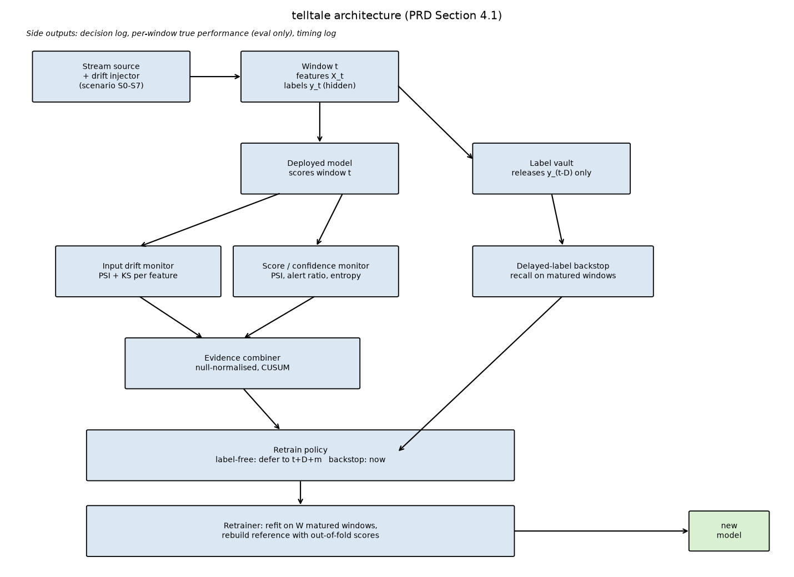

# telltale

Label-free drift detection and selective retraining for deployed fraud classifiers under delayed
ground truth.

A deployed fraud classifier degrades as fraud patterns shift, but the true labels needed to see
that directly are delayed, often by days to weeks, through disputes and chargebacks. telltale
watches the live stream of transactions and the model's own scores (both available instantly, no
label needed), raises an early alarm when the evidence of drift is strong and persistent, and
defers the retrain until enough post-alarm labels have matured. A slower, delayed-label backstop
catches the one thing label-free signals structurally cannot see: drift where the inputs look
unchanged and only the model's relationship to the label has moved.



## Quick start

```
python -m venv .venv
.venv\Scripts\activate          (Windows)
source .venv/bin/activate       (Linux/Mac)
pip install -r requirements.txt
pytest -q
python -m telltale.cli generate-samples
python -m telltale.cli tune
python -m telltale.cli run --config configs/pilot.yaml
python -m telltale.cli run --config configs/main.yaml
python -m telltale.cli profile
python -m telltale.cli make-figures
python -m telltale.cli real-check
python report/build_report.py
```

Requires Python 3.10 or newer (built and tested on 3.14; see `docs/decisions.md` for a couple of
version-specific workarounds that were needed).

## Results

Full main run: 10 evaluation seeds, 8 scenarios (S1 at three severities), 8 strategies, built into
`report/out/telltale_report.docx` and `results/summary.json`. Headline numbers:

- Label-free detection on moderate sudden covariate drift: median 0 windows of delay, against the
  delayed-label backstop's median 9 (paired Wilcoxon, p = 0.002). The same direction held across
  every covariate-drift scenario tested (H1, supported).
- The full framework used about 39 percent of a fixed retraining schedule's mean retrain count
  while keeping time-averaged recall within about 2 percent (relative) of it (H3, supported).
- On pure concept drift (S4), the label-free monitor correctly failed to detect the true onset in
  7 of 10 seeds; the backstop caught it at a median of 7 windows in every seed (H4, supported).
- False alarm rate (H5) held for the input-only signal, the backstop alone, and the label-free-only
  strategy, but the full combined framework and the score-only variant exceeded the 1-per-100
  target slightly (1.08 per 100 on the no-drift control): a genuine negative finding, investigated
  and reported honestly in the report's Section 13 and 14, not hidden.

See `results/figures/` for all plots, `results/pilot/` for the earlier 5-seed pilot run.

## Limitations

This is a controlled simulation, not a claim that the method works unmodified on a real bank's
fraud stream. The label-free monitors are blind to pure concept drift by construction (this is
tested directly, scenario S4, and is an honest negative result, not a bug); the backstop exists
specifically to catch what they cannot. Results come from a synthetic generator tuned to meet
stated acceptance criteria (PRD Section 5.3), and the one real-data check (the Kaggle credit card
fraud dataset) is detection-only, since the real dataset has too few frauds and too little natural
drift to retrain against safely. Evaluation used 10 seeds, not the PRD's default of 20, cut for
wall-clock feasibility on this machine (see `docs/decisions.md`); the statistics reported still use
a paired test across those 10 seeds, but a larger seed count would narrow the confidence intervals.

## Why the name

A telltale is a small signal that reveals something hidden, like the ribbons tied to a sailboat's
rigging that show how the wind is really flowing even when the sail itself looks fine. The
label-free signals in this project are the same idea applied to a fraud model: they reveal that
something underneath has shifted well before any confirmed label could prove it.
